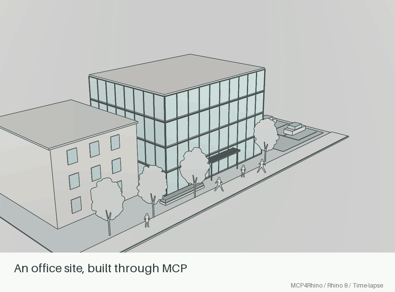
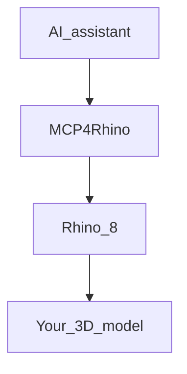
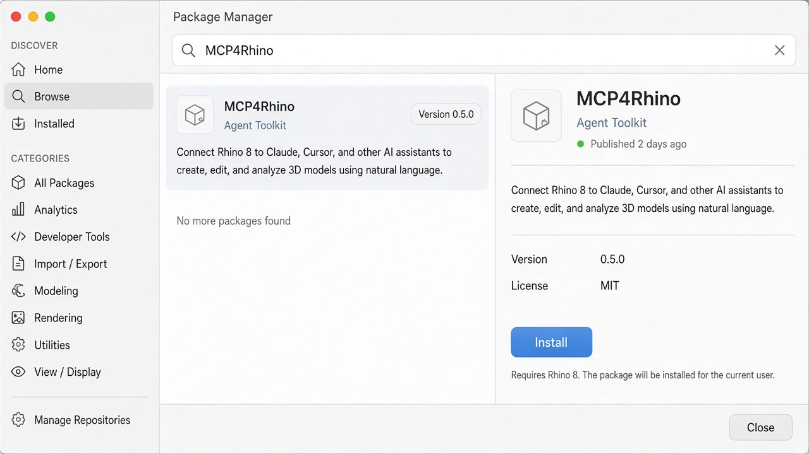

# MCP4Rhino

## Design and build 3D models in Rhino using AI

MCP4Rhino connects [Rhino 8](https://www.rhino3d.com/) to AI assistants such as Claude and Cursor. Describe what you want to create, modify, or inspect, and your AI assistant can work directly in Rhino.



A short time-lapse of MCP-driven construction in Rhino. [Watch the MP4](docs/media/mcp4rhino-office-park.mp4)

## What can you do?

### Create 3D models

Describe a design in natural language and have an AI assistant create geometry in Rhino.

> “Create a two-story office building with a central courtyard.”

### Modify existing models

Ask an assistant to inspect and change what is already in the document.

> “Make the second floor taller and add windows along the south wall.”

### Inspect and measure

Ask about dimensions, objects, layers, and geometry.

> “How wide is this building, and how many windows does it have?”

### Architectural design

Create walls, floors, roofs, doors, windows, stairs, spaces, and related elements.

> “Create a staircase connecting these two floors.”

### Parametric design with Grasshopper

Install or update **MCP4Rhino 0.7.1** from Rhino `PackageManager`, apply, and restart Rhino completely.

Create native, editable Grasshopper definitions, connect components, adjust parameters, inspect data trees, and explicitly bake geometry into Rhino.

> “Create a Grasshopper facade with adjustable panel count, spacing, and depth.”

Agents can learn the workflow through `gh_help`, the `grasshopper_getting_started` prompt, or the bundled [parametric design skill](skills/grasshopper-parametric-design/SKILL.md). See [Grasshopper support](docs/GRASSHOPPER.md) for setup, supported components and examples.

Discoverable read-only document/graph resources and reusable workflow prompts are documented in [resources, prompts and protocol compatibility](docs/MCP_RESOURCES_PROMPTS.md). Reading context does not initialize Grasshopper or modify a model.

### Drawings and documentation

Create section cutting planes and elevation baselines with named views, place dimensions and tags, register sheets in the document, and export (PDF is best-effort; DWG and images also available).

> “Create a section through the building and an elevation view of the front facade.”

### Design review

Run clash detection and preliminary code-style pre-checks. These are **findings only** — not a professional stamp or legal compliance claim.

> “Check the model for potential geometry conflicts.”

**Safety:** Your assistant can create, modify, and delete geometry. Review changes in Rhino before you rely on them.

## How it works

1. Install MCP4Rhino in Rhino.
2. Connect Claude, Cursor, or another compatible AI assistant.
3. Describe what you want to create or change.
4. Your assistant uses Rhino through MCP4Rhino to do the work.



[Model Context Protocol (MCP)](https://modelcontextprotocol.io/) is a standard that lets AI assistants connect to external applications and tools.

## Installation

**Requirements:** Rhino 8 on Windows or macOS, plus an MCP-compatible AI assistant ([Node.js](https://nodejs.org/) is needed for the usual Claude Desktop / Cursor bridge).

### Rhino Package Manager (recommended)

1. Open Rhino 8.
2. Type `PackageManager` in the Rhino command line and press Enter.
3. Search for **MCP4Rhino**.
4. Select the package published by **Agent Toolkit**.
5. Click **Install** and apply the changes.
6. Restart Rhino when prompted.
7. After restart, MCP4Rhino usually starts on its own. Confirm with **MCP4Rhino → Status…** (Windows: under **Tools**; macOS: top-level menu bar) or run `MCP4RhinoStatus`. If nothing is listening, use **Start server** or type `MCP4Rhino`.



### Install from a GitHub release

Download the universal `MCP4Rhino-<version>.yak` from the [latest release](https://github.com/isque03/mcp4rhino/releases), then:

```bash
# macOS
"/Applications/Rhino 8.app/Contents/Resources/bin/yak" install path/to/MCP4Rhino-<version>.yak
```

```powershell
# Windows
& "C:\Program Files\Rhino 8\System\Yak.exe" install path\to\MCP4Rhino-<version>.yak
```

Restart Rhino, then confirm with **MCP4Rhino → Status…** (Windows: under **Tools**; macOS: top-level menu) or run `MCP4RhinoStatus` / `MCP4Rhino`.

Building from this repository: [docs/INSTALL_FROM_SOURCE.md](docs/INSTALL_FROM_SOURCE.md).

**Linux:** Rhino 8 has no official Linux desktop. Run Rhino and MCP4Rhino on Windows or macOS. The MCP server listens on `127.0.0.1` only, so a remote Linux AI client cannot reach it via the Windows LAN IP. Run the AI client on the same machine as Rhino, or SSH-tunnel port 4010 (for example `ssh -L 4010:127.0.0.1:4010 user@windows-host`) and point the client at `http://127.0.0.1:4010/mcp`.

## Connect your AI assistant

Rhino must be open and MCP4Rhino must be running (see `MCP4RhinoStatus`) before your assistant can control the model.

Default endpoint: `http://127.0.0.1:4010/mcp`.

### Claude Desktop

Merge [examples/claude_desktop_config.json](examples/claude_desktop_config.json) into your Claude Desktop MCP config (typically under Claude’s application support / `%APPDATA%\Claude` on Windows), then restart Claude:

```json
{
  "mcpServers": {
    "mcp4rhino": {
      "command": "npx",
      "args": ["mcp-remote", "http://localhost:4010/mcp"]
    }
  }
}
```

### Cursor

Add an MCP server that runs:

```text
npx mcp-remote http://127.0.0.1:4010/mcp
```

Use Cursor’s MCP settings UI or project MCP config so the `mcp4rhino` server is enabled. Restart Cursor (or reload MCP) after saving.

If your AI client supports native HTTP MCP to that URL, you may use that instead of `mcp-remote`.

## Try your first command

With Rhino open, MCP4Rhino running, and your assistant connected, ask:

> “What objects are currently in my Rhino document?”

You should get a summary from the active document. Then try a small create or measure request and watch Rhino update.

## Features

| Capability | What you can do |
|------------|-----------------|
| Geometry | Create and edit curves, surfaces, and solids |
| Architecture | Levels, walls, slabs, roofs, openings, stairs, spaces |
| Inspection | List objects, measure size and distance, query the model |
| Drawings | Section planes + named views, elevation baselines, dimensions, tags, sheet registry, exports |
| Visualization | Camera control, illustration display, viewport capture |
| Analysis | Clash checks and preliminary code pre-checks |
| File export | Save `.3dm` (when Rhino allows); minimal IFC2X3 for tagged elements (bounding boxes); DWG; PDF (best-effort); images |

Full tool list: [docs/MCP_TOOLS.md](docs/MCP_TOOLS.md).

## Who is this for?

- Architects and designers exploring AI-assisted modeling
- Architecture students learning Rhino workflows
- Computational designers prototyping with language + geometry
- Developers building AI-assisted design tooling on Rhino

## Requirements and limitations

- Requires **Rhino 8** on **Windows** or **macOS**.
- You supply your own AI assistant (Claude, Cursor, or another MCP client). The plugin does not include an AI model.
- Rhino must be running for local modeling. Everything stays on your machine; cloud collaboration is not part of MCP4Rhino today.
- Review AI-generated changes. Automated design and code checks are preliminary and do not replace professional review.

## Usage data

MCP4Rhino sends anonymous usage data unless you turn it off. The agent is not asked to mention it, and tool calls are not blocked. Events are delivered to `https://events.agenttoolkit.ai/telemetry` using the install token shipped in the package. `MCP4RHINO_TELEMETRY_API_KEY` overrides that token. The value is one `X-Api-Key` header and is not part of the URL. If neither is set, or `MCP4RHINO_TELEMETRY_URL` is set to an invalid URL, the choice can be on and still nothing is sent. Events include a random installation id, plugin and Rhino versions, operating system, and which MCP tools ran (name, duration, and success). Version 0.7.1 adds controlled failure categories and the canonical name of a recognized leading Rhino command. Events do not include models, document names, prompts, scripts, arguments, results, error messages, or stack traces. Turn this off from **MCP4Rhino → Usage data…**. Details: [docs/TELEMETRY.md](docs/TELEMETRY.md).

## Documentation

**User docs (Mintlify):** [mcp4rhino.mintlify.app](https://mcp4rhino.mintlify.app/) — quickstart, how-tos, and tool reference.

| Doc | Audience |
|-----|----------|
| [docs/MCP_TOOLS.md](docs/MCP_TOOLS.md) | Tool reference (repo mirror) |
| [docs/TROUBLESHOOTING.md](docs/TROUBLESHOOTING.md) | Diagnostics |
| [docs/INSTALL_FROM_SOURCE.md](docs/INSTALL_FROM_SOURCE.md) | Source install |
| [docs/DEVELOPMENT.md](docs/DEVELOPMENT.md) | Contributors |
| [docs/TELEMETRY.md](docs/TELEMETRY.md) | Anonymous usage data |
| [docs/ARCHITECTURE_AGENT.md](docs/ARCHITECTURE_AGENT.md) | Architecture agent roadmap |
| [CHANGELOG.md](CHANGELOG.md) | Release history |
| [CLAUDE.md](CLAUDE.md) | Coding-agent playbook for this repo |

## Feedback and issues

Bugs and enhancement requests: [GitHub Issues](https://github.com/isque03/mcp4rhino/issues).

From Rhino: **MCP4Rhino → Report issue…**, or ask your AI assistant to call `get_support_info` before filing (includes version, endpoint, and filing tips).

## Troubleshooting

| Problem | What to try |
|---------|-------------|
| Assistant cannot connect | Open **MCP4Rhino → Status…**. Start the server if Stopped. Restart the AI client after changing MCP config. |
| MCP4Rhino does not appear in Rhino | Check Package Manager install, restart Rhino, search commands for `MCP4Rhino`. |
| Assistant cannot modify the model | Confirm Status shows Running, watch the Rhino command line for errors, see [docs/TROUBLESHOOTING.md](docs/TROUBLESHOOTING.md). |

## Contributing

See [CONTRIBUTING.md](CONTRIBUTING.md). Use [GitHub Issues](https://github.com/isque03/mcp4rhino/issues) for bugs and feature ideas.

## License

MIT — see [LICENSE](LICENSE).
